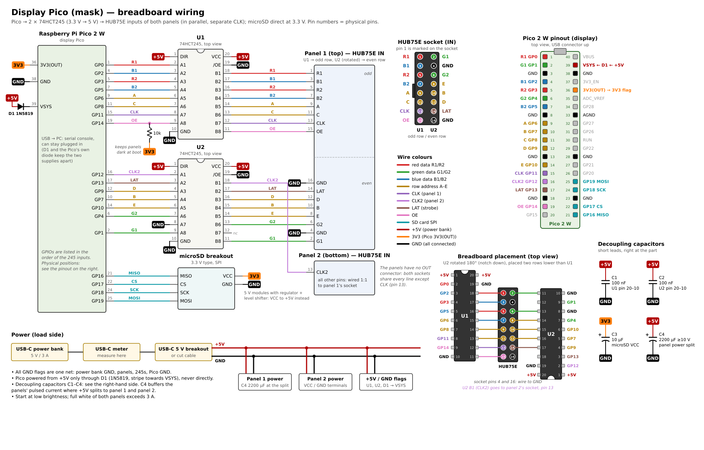
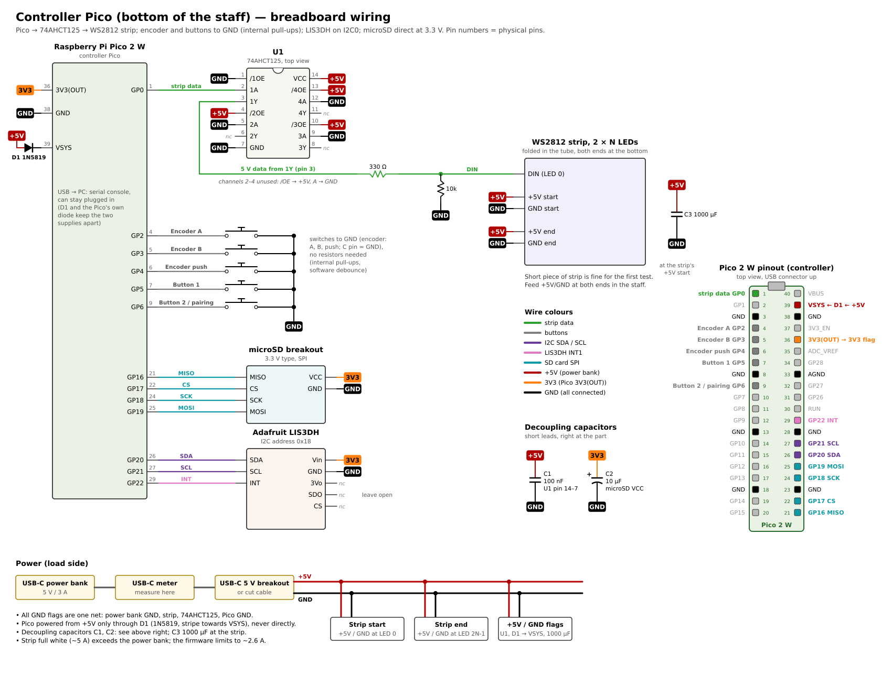

# Breadboard bring-up

Wiring and test procedure for the first hardware tests (milestones 1–3 and 5).
Pin numbers in brackets are physical Pico header pins.

Wiring diagrams (open in a browser; regenerate with `python3 tools/wiring_diagrams.py`):

- [wiring_display.svg](wiring_display.svg) — display Pico, 2 × 74HCT245, HUB75E, microSD
- [wiring_controller.svg](wiring_controller.svg) — controller Pico, 74AHCT125, strip, buttons,
  LIS3DH, microSD

Design reference (pins, formats, power limits, sync protocol): [design.md](design.md).

## Build and flash

```sh
export PICO_SDK_PATH=~/pico/pico-sdk        # pico-sdk 2.3.1
cmake -S . -B build && cmake --build build -j8
```

Hold BOOTSEL while plugging in the Pico, then copy `build/display/display.uf2` or
`build/controller/controller.uf2` to the `RP2350` drive (`build/controller/bt_test.uf2` is the
Bluetooth test firmware for the controller, see the last section). Open the serial console with e.g.
`picocom /dev/ttyACM0` or `screen /dev/ttyACM0`. Both firmwares print a help text on
connect; `h` shows it again.

The onboard LED (driven through the CYW43 chip) blinks slowly when the firmware runs. On the
controller it blinks fast if the strip or the LIS3DH failed to initialise.

## Power

- Each Pico is powered from its board's +5V rail through a Schottky diode D1 (1N5819) into
  VSYS (pin 39): anode to +5V, cathode (stripe) to VSYS. Together with the Pico's own diode from
  VBUS to VSYS, the higher of the two supplies powers the Pico and neither feeds back into the
  other, so USB to the PC can stay plugged in for the serial console. Never connect +5V to VSYS
  or VBUS without D1. **Connect all grounds.**
- Avoid running the Pico from USB alone for long while the level shifters are unpowered: the
  Pico's outputs then feed the unpowered chips through their input protection diodes. Switch the
  power bank on first, or together with USB.
- Level shifters run at VCC = 5 V (the panel/strip supply). Unused inputs must never float:
  tie them to GND.
- Decoupling capacitors (drawn on the diagrams, keep the leads short):
  - 100 nF ceramic from VCC to GND directly at every level shifter chip (245: pins 20–10,
    AHCT125: pins 14–7). Mandatory — without it the display shows random glitches.
  - 10 µF at the microSD breakout's VCC (3V3).
  - Controller: 1000 µF across the strip supply at the strip's start.
  - Display: 2200 µF (≥ 10 V, mind the polarity) across +5V/GND where the supply splits to the
    two panels. If the power bank switches off the moment you plug in the load (inrush into the
    big capacitors), switch the power bank on first, then connect the load.
- Display: 2 × 74HCT245 (DIP-20). DIR (pin 1) to VCC (A → B), /OE (pin 19) to GND, GND (pin 10),
  VCC (pin 20). Inputs A1–A8 = pins 2–9, outputs B1–B8 = pins 18–11.
- Controller: 1 × 74AHCT125 (DIP-14), channel 1 only. /1OE (pin 1) to GND, 1A (pin 2) input,
  1Y (pin 3) output, GND (pin 7), VCC (pin 14). Unused channels 2–4: /OE (pins 4, 10, 13) to VCC,
  A inputs (pins 5, 9, 12) to GND, Y outputs (pins 6, 8, 11) open.

## Display Pico



Each 245 feeds one row of the HUB75E socket 1:1, so the 245 outputs need no crossing wires.
Placement (see "Breadboard placement" in the diagram): U1 left of the socket, notch up, its
B side facing the odd row; U2 right of the socket, **rotated 180° (notch down)** and two rows
lower, its B side facing the even row. The rotation reverses U2's order: B8 (pin 11) is next to
socket pin 2, B1 (pin 18) next to pin 16. The reordering happens on the Pico → A side. U2's
unused channel B7 sits at the socket's GND pin 4; channel B1 (next to GND pin 16) carries CLK2
for panel 2 and does **not** connect to this socket.

| 245 channel | chip pins (A → B) | Pico | HUB75 socket (pin) |
|---|---|---|---|
| U1 A1 → B1 | 2 → 18 | GP0 [1] | R1 (1) |
| U1 A2 → B2 | 3 → 17 | GP2 [4] | B1 (3) |
| U1 A3 → B3 | 4 → 16 | GP3 [5] | R2 (5) |
| U1 A4 → B4 | 5 → 15 | GP5 [7] | B2 (7) |
| U1 A5 → B5 | 6 → 14 | GP6 [9] | A (9) |
| U1 A6 → B6 | 7 → 13 | GP8 [11] | C (11) |
| U1 A7 → B7 | 8 → 12 | GP11 [15] | CLK (13), panel 1 only |
| U1 A8 → B8 | 9 → 11 | GP14 [19] + 10 kΩ pull-up to 3V3 | OE (15) |
| U2 A8 → B8 | 9 → 11 | GP1 [2] | G1 (2) |
| U2 A7 → B7 | 8 → 12 | A7 to GND, B7 open | — (pin 4 = GND, wire to GND) |
| U2 A6 → B6 | 7 → 13 | GP4 [6] | G2 (6) |
| U2 A5 → B5 | 6 → 14 | GP10 [14] | E (8) |
| U2 A4 → B4 | 5 → 15 | GP7 [10] | B (10) |
| U2 A3 → B3 | 4 → 16 | GP9 [12] | D (12) |
| U2 A2 → B2 | 3 → 17 | GP13 [17] | LAT/STB (14) |
| U2 A1 → B1 | 2 → 18 | GP12 [16] | CLK2 → **panel 2 socket** pin 13 (pin 16 = GND, wire to GND) |

U2 rows are listed in the order they appear next to the socket (top to bottom). If the socket
ends up mirrored, reverse the order on the Pico → A side instead (and update
`tools/wiring_diagrams.py`); the firmware does not care which 245 channel carries a signal.

HUB75E connector (look at the panel's IN socket, key notch; pin 1 is marked):

```
R1  1  2 G1
B1  3  4 GND
R2  5  6 G2
B2  7  8 E
A   9 10 B
C  11 12 D
CLK 13 14 LAT
OE 15 16 GND
```

The panels have no OUT connector and are not chained. Each panel gets its own ribbon cable and
socket. Wire the second socket (panel 2) **pin by pin in parallel** to the first one: all 16 pins
including the GND pins 4 and 16, **except pin 13**. Pin 13 of panel 1's socket gets CLK (U1 B7),
pin 13 of panel 2's socket gets CLK2 (U2 B1). Panel 1 is the top panel by default (`t` swaps).
Keep the wires from the 245s to the sockets short.

### Display tests

The firmware boots into the video player (base scene). The test patterns below are on keys
`0`–`7`; `v` returns to the video. Start with brightness at the default (25/255 ≈ 10 %).

0. Check `p`: rows must read "SM5368 shift register" and colour order "B-G-R" for the project's
   panels (`a` and `b` toggle them for other panels).
1. **Pattern 0 (mapping)**: top panel shows "TOP" in a red frame, bottom panel "BOT" in a
   green frame. White square top left, yellow top right, blue bottom left.
   - Panels swapped: `t`. Text upside down on one panel: `r` (top) or `R` (bottom).
   - One panel dark or showing noise while the other works: check its CLK line (pin 13 of its
     socket: CLK for panel 1, CLK2 for panel 2).
   - Nothing at all: try `f` (reboots with the FM6126A init sequence).
   - Garbage, flicker or shifted pixels: slower CLK with `c` (check `p` for the MHz).
   - Write down the working settings (`p`); they go into the config later.
2. **Pattern 5 (row scan)**: a single line walks down both panels, one row per 250 ms, and the
   serial console prints the row. A skipped or doubled row points to a bad address line (A–E).
3. **Patterns 1 and 2**: colour bars and gradients. Wrong colours = swapped data lines.
   Ramps should look smooth (gamma 2.2).
4. **Pattern 4 (checkerboard)** and **3 (moving lines)**: look for ghosting (faint copies
   above/below) and tearing. `p` shows the refresh rate (should be > 150 Hz).
5. Try faster CLK (`C`) until the image breaks, then go back two steps. Note the divider.
6. **Pattern 6 (full white)** for the current measurement: read the USB-C meter on the panel
   supply at 10 % brightness, then at 20 % (`+` twice), and at black (pattern 7) for the idle
   current. Do not go much higher on a 3 A power bank.
7. **SD card** (`s`): same test as on the controller (step 8 there), but with the panels
   running: refresh is PIO + DMA and continues during the test, so the SD transfers share the
   DMA bus with the panel refresh like during video playback. Run it with pattern 3 (moving
   lines; the picture freezes during the test) and watch for flicker. `S` cycles the SD clock.
   Expected: "SD OK", read rate > 1 MB/s, worst chunk well below 40 ms.
8. **Video**: `python3 tools/make_scenes.py` renders the scenes into `media/sd_display/` (previews in
   `media/preview/`). Copy the `.vid` files to the root of a freshly formatted FAT32 card.
   After boot the eyes play; `v` / `V` cycle the scenes (eyes, fire skull, matrix, lightning
   skull). `p` shows per scene: frames shown / skipped (late) / read errors, and read and show
   time per frame: both together must stay below 40 ms (25 fps), "skipped" should stay 0.
   Without a card (or a missing file) the built-in fallback eyes show and the player retries
   every 2 s: pull the card during playback and put it back.
9. **Current limiter**: pattern 6 (full white), raise the brightness with `+` while watching
   the meter: from ~75/255 on, `p` shows the limiter brightness below the set one and the
   meter must stay near 2.6 A.

## Controller Pico



| Pico | Connects to | Notes |
|---|---|---|
| GP0 [1] | 74AHCT125 1A (pin 2); 1Y (pin 3) → 330 Ω → strip DIN | 10 kΩ pull-down on DIN |
| GP2 [4] | EC11 encoder A | encoder C pin to GND; internal pull-ups on all five |
| GP3 [5] | EC11 encoder B | |
| GP4 [6] | encoder push button to GND | |
| GP5 [7] | button 1 to GND | |
| GP6 [9] | button 2 (pairing / menu) to GND | |
| GP20 [26] | LIS3DH SDA | |
| GP21 [27] | LIS3DH SCL | |
| GND [28] | LIS3DH GND | |
| GP22 [29] | LIS3DH INT | (the breakout's INT pin is INT1) |
| 3V3(OUT) [36] | LIS3DH Vin | leave SDO, CS, INT2 and A1–A3 unconnected |

Strip power: 5 V and GND from the power bank to **both** ends of the strip (as in the staff),
1000 µF across the supply at the strip. For the first test a short piece of strip is enough:
LEDs that don't exist are simply not shown.

### Controller tests

1. **Status** (`p`): LIS3DH found? If "NOT FOUND": check SDA/SCL, and that Vin goes to 3V3.
2. **Colour order** (`e` until "TEST colour order"): LEDs #1–#3 (bottom of the
   front, where the data enters) must be red, green, blue. Otherwise press `o` until they are.
   Note the order.
3. **LED count** (`e` → "TEST chase"): one LED walks through the strip, the console prints its
   number (counted from 1). Set LEDs per side with `n`/`N` (default 90).
4. **Fold** (`e` → "TEST fold"): once the strip is folded: red marker (front) and blue marker
   (back) must be at the same height, green at the bottom (electronics), white at the top.
4a. **Layout** (`e` → "TEST layout", on the assembled staff): the body is dim, the crystal
   (top pairs, `k`/`K` changes how many) cyan, dead heights red. Turn the encoder to move the
   white marker; the console prints its LED numbers. Push the encoder to mark the marker height
   as dead (hidden by the grip or a connector ring) or to unmark it. `L` prints the dead list in
   front LED numbers (e.g. `31-42, 61-63`); it goes into `STRIP_DEFAULT_DEAD` in
   `controller/strip.h` (later `config.ini`). Settings made here are lost on reboot. Current
   staff (2026-10-10): crystal = top 3 pairs, dead `65-72, 87` (built in).
5. **Current** (USB-C meter between power bank and staff, whole staff incl. Pico; the limiter
   keeps the estimate below 2.6 A at the power bank):
   1. `e` until "off" (strip dark), wait a few seconds, `m`, type the meter reading in mA, Enter:
      that is the base current (Pico + black strip).
   2. `e` until "TEST full colour" (white; dead LEDs stay off), `m`, type the reading: the firmware
      computes the mA per channel and uses it right away.
   3. `+` until `p` shows "(LIMITED)", then `m` again with the new reading (the value near the
      limit counts most; long strips lose some current to voltage drop). Repeat until the meter
      and the estimate from `p` agree near 2.6 A.
   The firmware prints the two values for `controller/strip.h`; report them, they are lost on
   reboot. Built in since 2026-10-10: base 136 mA, 8.931 mA per channel.
   4. Single colours: `w` cycles red, green, blue. At "(LIMITED)" the meter must stay near
      2.6 A for each (do not press `m` here, it would overwrite the white calibration). Red
      LEDs need less voltage, so they may keep more current where the strip voltage sags.
6. **Controls**: turning the encoder selects a scene of the playlist (serial "selected: ...",
   the crystal breathes in its colour; check that clockwise goes forward, else set
   `ENCODER_REVERSE` in `controller/encoder.h`; one detent must be one step, else
   `ENCODER_TRANSITIONS_PER_DETENT`). Encoder push drops the selection, long push pairs the
   speaker. Button 1 fires the selected scene directly, long press fires the base scene.
   Button 2 returns to the base scene (from there it selects the playlist's first scene), long
   press switches the playlist (crystal white = scenes, rainbow = fun,
   pink-gold = family). The built-in effects and
   LED tests are on the console (`e`, back with `b`). Watch for steps or presses that happen
   by themselves while the strip runs bright effects: that would be noise on the long cable
   (fix: 10 kΩ pull-ups and 10 nF on A/B at the board).
7. **Stomp**: tap the breadboard or the sensor on the table: "stomp: ..." lines appear. With a
   scene selected, the scene fires; without, only the impact wave runs up the strip.
   `a` switches the tilt check off (90°) while the sensor lies flat on the table.
8. **SD card** (`s`, card FAT32-formatted, any content): prints card and file system info and
   the root directory, writes a 4 MB test file, reads it back in 32 KB chunks (one video
   frame) and verifies it, then deletes it. Must end in "SD OK" with a read rate above 1 MB/s
   and a worst chunk time well below 40 ms. The strip pauses during the test. `c` cycles the
   SPI clock (12.5 / 25 / 37.5 MHz) for the next run: if 25 MHz fails on the breadboard but
   12.5 MHz works, suspect wire length or the missing 10 µF; 37.5 MHz is above the SD spec
   and only shows the margin.

### Link test: face and staff together (milestone 8)

Both boards with the current firmware (`display.uf2`, `controller.uf2`), the display with its
SD card. Two serial consoles help but are not needed.

1. **Connect**: power both. The controller prints "BLE: display found", "connected" and "link
   to the display ready" within a few seconds. `l` on the controller: state "connected",
   pings answered, "sync: ... usable", and "display: scene 0, video ok". `l` on the display:
   pings answered and heartbeats about once per second.
2. **Fire**: select a scene on the staff, stomp (or button 1, or `f` on the console).
   The impact wave starts at once; about 0.25 s later the staff effect and the mask's video
   change together. The display prints "link: scene N ..., starts in ... ms": that is the
   margin left of the 250 ms; it should be well above 0 (typically 150–220 ms). A negative
   value means the event arrived late: the video then starts at the frame it would already be
   at, so it stays in step with the staff.
3. **Sync by eye**: fire back and forth between the base scene (button 1 long) and the fire
   skull. Do mask and staff switch at the same moment? (Target: within ~20 ms, i.e. no visible
   offset. If one side is consistently late, report which.)
4. **Missed event**: unplug the display, fire a scene on the staff, plug the display back in.
   Within a few seconds after the link is back, the mask switches to the staff's scene
   ("missed events taken from a heartbeat" in the display's `l`). The other way round: reset
   the controller while the mask shows a scene: the mask returns to the base scene with the
   staff.
5. **Without link**: with the display off, firing still changes the staff ("display not
   connected" on the console). Local display keys (`v`) still work and stay until the next
   fire from the staff.

### Sound (milestone 9)

`python3 tools/make_sounds.py` writes the clips to `media/sd_controller/`; copy the `.wav`
files to the root of the controller's SD card (FAT32).

1. **Speaker**: switch the JBL on. The controller connects to the speaker paired with
   `bt_test` by itself ("BT: streaming" on the console, `l` shows the stream). Otherwise:
   speaker in pairing mode, then encoder long push (or `P`); the crystal blinks blue while
   searching.
2. **Fire**: every scene plays its clip together with the change on staff and mask (the sound
   is scheduled at the stomp and heard L_bt = 250 ms later). `l` shows "clips: card mounted,
   ... played, 0 underruns". Does the sound line up with the picture? Timing to try: `i`
   starts the impact wave at the stomp or with the sound (default), `(` / `)` delay the scene
   change after the sound in 100 ms steps (e.g. 400: when the wave reaches the crystal).
3. **Strip while streaming**: do the strip effects still run smoothly (no stutter) with the
   stream running and while clips play?
4. **Without speaker / card**: switch the speaker off: firing still works without sound
   ("no speaker stream"), and the controller reconnects when the speaker is back on. Without
   a card: no sound, everything else works.

### Intros, staff animations, brightness, watchdog (2026-10-11)

`python3 tools/make_scenes.py` and `python3 tools/make_sounds.py`; copy `media/sd_display/*`
to the display's card and `media/sd_controller/*` (`.wav` and `.led`) to the controller's card.

1. **Boot**: the eyes open on the mask, an ember glow sinks down the staff, then the staff is
   dark. `p` on the controller: "staff animation: ..." (the eyes have only an intro).
2. **Intros**: fire each scene. Mask and staff play their intro together with the sound, then
   loop. The fire skull: fireball behind the nose / up the staff; lightning: strike from above;
   matrix: falling curtain; rainbow (fun playlist, button 2 long): rainbow front from the
   bottom. Without the `.led` files the staff shows the old built-in effects.
3. **Brightness**: both boards now start at 255/255. Watch the meters: the mask should stay
   below ~1.8 A in the loops (fire skull the highest), the staff below ~1.5 A; `p` shows
   "(LIMITED)" / the limiter brightness only during flashes and bursts. Too bright or too
   hot behind the shield? Report the brightness you prefer (`+`/`-` on either console).
4. **Watchdog**: `p` shows "LAST RESET BY THE WATCHDOG" only after a hang. Normal use (SD
   test, meter prompt) must not trigger it.

### New scenes and crystal gradients (2026-10-11)

Regenerate and copy as above (both cards get new files; the rainbow scene's files changed).
For the Rick Roll put your clip at `sound original/rick.wav` (any format ffmpeg reads, any
length) before running `make_sounds.py`; without it the scene fires silently.

1. **Crystal**: select each scene with the encoder; each shows its own three-colour gradient
   (bottom to top), e.g. fire red-orange-yellow, creeper green-dark-green,
   pumpkin orange-orange-green. Check that neighbouring scenes can be told apart.
2. **Serious playlist** (encoder): eyes, fire skull, matrix, lightning, Darth Maul (not
   included in this repository), pumpkin (candle catches).
3. **Fun playlist** (button 2 long): eyes, rainbow fire skull, YouTube (bubbles readable?),
   creeper (flashes white with the staff once per loop), Rick Astley.
4. Console: `0`-`9` select scene 0-9 directly; on the display `v`/`V` step through all ten.

### Tuning the stomp detection (on the real staff, later)

```sh
pip install pyserial matplotlib
python3 tools/plot_accel.py record /dev/ttyACM0 stomps.csv    # stomp 10x, Ctrl+C
python3 tools/plot_accel.py record /dev/ttyACM0 walking.csv   # walk with the staff
python3 tools/plot_accel.py record /dev/ttyACM0 waving.csv    # wave it around
python3 tools/plot_accel.py plot stomps.csv --axis y
```

Choose the threshold (`[`/`]`, 125 mg steps) between the walking peaks and the stomp peaks.
The staff axis is Y on the assembled staff (default; `x` cycles it, `p` shows the gravity
vector: the staff axis reads ~1 g while the staff is upright).

## Bluetooth test (milestone 4)

Question: can one CYW43439 on the controller stream A2DP to the speaker **and** keep a link to
the display at the same time?

- **Wi-Fi (tested 2026-10-09): no.** With the controller associated to the display's access
  point, 20–25 % of the audio was dropped (gaps up to 155 ms); with Wi-Fi off the stream was
  clean. The Wi-Fi link code is not part of this repository.
- **BLE (current):** the display is a BLE peripheral, the controller connects as central. The
  A2DP link and the BLE link are scheduled by the same Bluetooth controller instead of sharing
  the antenna with Wi-Fi. Tested 2026-10-09: no audio dropped, neither with 20 Hz pings nor
  while scanning (max backlog 90 ms while scanning, ~50 ms while connected). Clock sync over
  the link (step 2): filtered offset stable within ~1 ms over 11 min, drift ~2 ppm. Run it
  from the power bank: on USB only (strip unpowered) the audio had dropouts.

Firmware: `build/display/display.uf2` on the display (advertises as "matrixmask mask" and answers
pings; `l` prints the link status) and `build/controller/bt_test.uf2` on the controller
(`bt_test_hcidump.uf2` additionally logs every HCI packet). The normal controller firmware
(`controller.uf2`) is unchanged; flash it back for strip and stomp tests. The strip only shows
status: top LED of side 0 = speaker, side 1 = link to the display (colours in the help text,
`h`). Start with the speaker volume low.

1. **Pairing**: speaker in pairing mode, then `P` (or long press on button 2). Expected:
   "found ... -> audio sink", the `BT hci:` pairing steps, "connected", "SBC 44100 Hz ...",
   "streaming", and the speaker LED turns green. The speaker is stored in flash: after a power
   cycle of the controller it reconnects by itself (note how long it takes). `X` forgets it.
2. **Link**: with the display running, "BLE: display found", "connected, interval 30.00 ms",
   "link to the display ready", and the link LED turns green. The status (every 10 s, `v`
   toggles, `p` prints now) shows pings sent/answered/lost, RSSI, RTT (expect about one to two
   connection intervals, 30–60 ms) and an RTT histogram. The `sync:` line shows the clock
   sync: the display's receive time is compared with ours one connection event (30.00 ms)
   later, using only answers with RTT < 2 intervals. "connection-event offset spread" is the
   scatter of these estimates (expect a few ms; the filter takes the median of the last 9);
   the NTP spread and bias show what plain RTT/2 compensation would give; drift is the rate
   difference of the two Pico clocks (expect tens of ppm).
3. **Audio with and without the link**: `t` plays a continuous tone (dropouts are easy to hear).
   Listen ~5 min each with `l` set to 20 Hz pings (stress), 5 Hz (about the real rate) and off.
   For each, note from the status lines: speaker "skipped" (audio dropped because the radio
   stalled), "max gap", "max backlog"; link lost pings, RTT histogram, offset spread.
4. **Latency** `L_bt`: `m` starts a metronome (click + strip flash every second). Change `L_bt`
   with `+`/`-` (5 ms, or the encoder) and `<`/`>` (50 ms) until click and flash coincide to
   eye and ear (JBL Flip 7: 250 ms). If the speaker sends a delay report, the status shows it.
   Check `L_bt` again after the stream has run for an hour (clock drift between Pico and
   speaker).
5. **Robustness**:
   - Speaker off and on again: the controller retries every ~5 s; how long until it streams again?
   - Play/pause button on the speaker: the stream is restarted ("suspended ... restarting").
   - Display off and on again: the controller scans (20 % duty) until it finds it. Does the
     scanning disturb the audio (`t`)? How long until the link is back?
   - Leave it idle for 30 min: does the speaker switch itself off during silence? If so,
     repeat with `z` (very quiet noise instead of digital silence).
   - Wearing test: speaker under the robe, controller in the other hand / a bag, display on
     the head: dropouts, link losses?

**Decision**: clean audio with the link at 5 Hz (no or rare "skipped") and few lost pings → one
radio per board is enough. Otherwise: lower the link rate, or a separate microcontroller for the
link.
