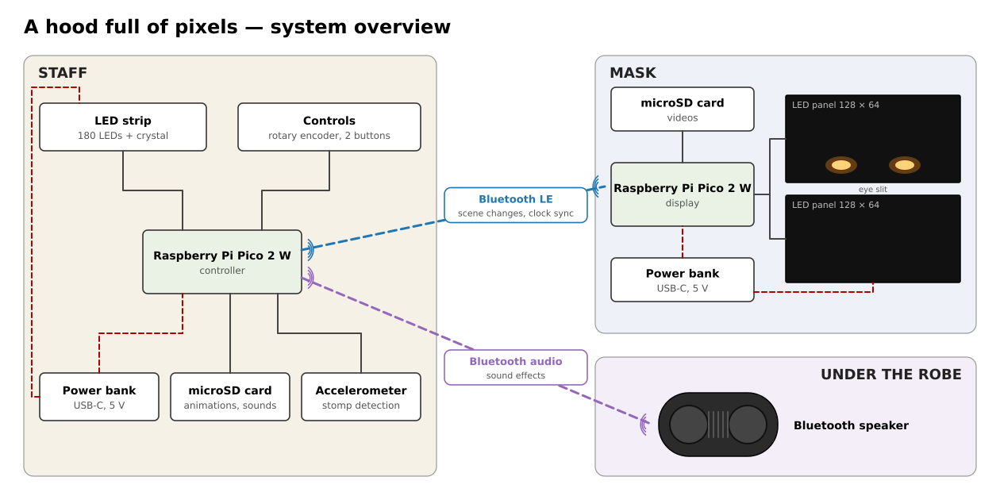

# Design notes

Technical reference for the firmware and tools: pins, behaviour, file formats, power limiting
and the sync protocol. Build overview and licences: [README](../README.md). Wiring and bring-up
tests: [breadboard.md](breadboard.md). Mask geometry: [mask_geometry.md](mask_geometry.md).

## System overview

- **Display Pico** (in the mask) drives two 128x64 HUB75E panels (logical 128x128), plays
  video from a microSD card and is the BLE peripheral of the link to the controller.
- **Controller Pico** (at the bottom of the staff) reads the rotary encoder, two buttons and an
  LIS3DH accelerometer, drives the WS2812-type strip (2 × 90 LEDs), streams audio to a
  Bluetooth speaker (A2DP source), reads sounds and strip animations from its own microSD card
  and is the time master. It connects to the display Pico as BLE central.
- Each Pico runs from its own USB-C power bank (5 V / 3 A). The Pico is fed from the board's
  +5V rail through a 1N5819 Schottky diode into VSYS.

### Scenes

A **scene** is a panel intro video, a panel loop video, a strip intro, a strip loop and a sound
(each optional) plus a crystal colour. Scene 0 is the **base scene** (glowing eyes, dark staff)
and plays after boot. The scene table lives in `controller/main.c` and `display/player.c`; the
scene numbers must match on both boards.

| # | Scene | Mask | Staff | Sound |
|---|---|---|---|---|
| 0 | eyes (base) | two glowing eyes; intro: they open | dark; intro: an ember glow sinks down | bass growl |
| 1 | fire skull | skull of particle flames, black sockets, nose, teeth; intro: a fireball explodes behind the nose | particle fire; intro: a fireball shoots up | wet spell shoot |
| 2 | matrix | green glyph rain, brighter where the face is | falling green drops | impact |
| 3 | lightning skull | glowing sockets, nose and teeth, arcs crawling around them | dim blue with flickering bolts | impact |
| 4 | rainbow fire skull | the fire skull in rainbow colours | rainbow particle fire | chime (synthesised) |
| 5 | youtube | red logo box with eyes and a smile, "like!" / "subscribe!" bubbles | progress bar filling up | pop + ding (synthesised) |
| 6 | darth maul | *not included in this repository* | | |
| 7 | creeper | swells and flashes white once per loop | green pixel blocks flashing with it | fuse hiss (synthesised) |
| 8 | rick astley | faces from the music video (bring your own copy, see below), otherwise a drawn portrait | neon equaliser | the song |
| 9 | pumpkin | carved jack-o'-lantern with candle flicker | ember glow with rising sparks | whoosh + boom (synthesised) |
| 10 | family | faces from your own photos (`tools/family.py`), not included | golden glitter | chime |
| 11 | me | my face talking (an example for `tools/facetrack.py`) | equaliser of the jingle, then teal waves | my jingle |

Playlists (encoder): *scenes* = 0, 1, 2, 3, 6, 9; *fun* = 0, 4, 5, 7, 8, 11; *family* = 0, 10.
Scenes without files on the SD cards still work: the mask shows the built-in fallback eyes, the
staff a built-in effect, and the scene fires without sound.

### Controls and behaviour

1. **Boot**: both devices start the base scene on their own, without waiting for the link or
   the speaker. The A2DP stream plays silence while no sound plays.
2. **Select** with the controls on the staff. The crystal at the top shows the current scene
   steady and dim (dark for the base scene) and the selected scene breathing bright; each scene
   has its own three-colour gradient (table in `controller/main.c`).
   - encoder turn: select within the current playlist; push: drop the selection; long push:
     pair the speaker (the crystal blinks blue while searching);
   - button 1: fire the selected scene directly; long: fire the base scene;
   - button 2: back to the base scene, or, if already there, select the playlist's first scene;
     long: switch playlist (the crystal shows white / rainbow / pink-gold for 1.5 s).
3. **Fire**: a stomp detected by the accelerometer fires the selected scene. Stomps without a
   selection only show a short impact wave. The staff touches the floor all the time while
   walking, so the selection is the main protection against false triggers.
4. On a fire the sound starts at once; the intros on mask and staff start `L_bt` later, when
   the speaker actually plays the sound (see the sync protocol). After the intro both devices
   switch to the scene's loop independently.

### Costume constraints

- **Graceful degradation**: each device is useful on its own. Without the link the display
  keeps looping its current scene; without the speaker the controller still fires the
  visuals. Links reconnect automatically and never block.
- **Fast, headless boot**: a power glitch from a stomp must end in the base scene within a few
  seconds. **Watchdog** (5 s) on both boards.
- **Shock**: the controller sits at the impact. SD read errors are retried or skipped, never
  hang the firmware. Mechanically: secure the SD card, strain-relieve cables and solder joints.
- The wearer cannot see the panels. The only feedback is on the staff (crystal) and the USB
  serial logs.

## Hardware

### Display Pico

| GPIO | Function | Notes |
|---|---|---|
| GP0–GP5 | R1 G1 B1 R2 G2 B2 | via 74HCT245, both panels |
| GP6–GP10 | Row A, B, C, D, E | via 74HCT245, both panels |
| GP11 | CLK1 (panel 1) | via 74HCT245 |
| GP12 | CLK2 (panel 2) | via 74HCT245 |
| GP13 | LAT (strobe) | via 74HCT245, both panels |
| GP14 | OE (active low) | via 74HCT245, both panels; 10k pull-up to 3V3 keeps the panels dark at boot |
| GP16 | SD MISO (SPI0 RX) | direct, 3.3 V |
| GP17 | SD CS | |
| GP18 | SD SCK | |
| GP19 | SD MOSI (SPI0 TX) | |

- The panels have **no OUT connector**, so they cannot be chained. All lines are wired in
  parallel to both HUB75 connectors except CLK: panel 1 gets CLK1, panel 2 CLK2. Per row the
  data PIO shifts panel 1's 128 pixels with CLK1 (panel 2 ignores them), then panel 2's with
  CLK2, and one LAT pulse latches both. Timing and framebuffer layout equal a 256x64 chain.
- The PIO driver needs consecutive GPIO groups (data base 0, row base 6, CLK2 = CLK1 + 1,
  OE = LAT + 1 as side-set pairs); do not reorder them to simplify the wiring.
- Mounted as 128x128 (two panels stacked with the eye slit between them). Which panel is on
  top and whether either is rotated by 180° is a setting (serial commands, defaults in
  `display/hub75.c`); on my mask panel 1 is on top, no rotation.
- Panels: 1/32 scan, **FM6124C** column drivers (no init sequence needed; the FM6126A init is
  available) and **SM5368** shift-register row drivers (A = row clock, B = shift enable,
  C = row data, D/E unused). Binary A–E row addressing is selectable for other panels. The
  colour order of my panels is B-G-R, handled in the firmware.
- 74HCT245 wiring: channels map 1:1 to the rows of the HUB75E socket, see
  [breadboard.md](breadboard.md) and [wiring_display.svg](wiring_display.svg).

### Controller Pico

| GPIO | Function | Notes |
|---|---|---|
| GP0 | WS2812 data | via 74AHCT125 channel 1 + 330 Ω series resistor; 10k pull-down |
| GP2 | Rotary encoder A (EC11) | |
| GP3 | Rotary encoder B | |
| GP4 | Encoder push button | |
| GP5 | Button 1 | |
| GP6 | Button 2 (menu) | |
| GP16–GP19 | SD card, same as on the display Pico | SPI0 |
| GP20 | LIS3DH SDA (I2C0) | the Adafruit breakout has pull-ups |
| GP21 | LIS3DH SCL (I2C0) | |
| GP22 | LIS3DH INT1 | push-pull, active high |

- Encoder C pin and one side of every switch go to GND; the five signals use the internal
  pull-ups and are debounced in software. If the long cable next to the strip picks up noise:
  10 kΩ pull-ups to 3V3 on all five and 10 nF to GND on A/B at the board.
- **Strip layout**: data enters at the **bottom**, the strip runs up the front, folds at the
  top and runs back down the back. 2 × N LEDs, N = 90 (`STRIP_DEFAULT_PER_SIDE` in
  `controller/strip.h`). Firmware index 0 is at the bottom of the front, N-1 and N at the top,
  2N-1 at the bottom of the back. LED numbers in settings and on the serial console count from 1
  and name the front LED (the back LED at the same height is included). Power is fed at both
  ends of the strip.
- **Crystal**: the three top-most LED pairs light the crystal (`STRIP_DEFAULT_CRYSTAL_PAIRS`).
  The current limiter never dims them.
- **Dead LEDs**: the grip and the connector rings hide some LEDs. They count as positions for
  effects but stay off (`STRIP_DEFAULT_DEAD`, front LED numbers such as `"65-72, 87"`). The
  `L` command prints the layout, and the LED test lets you mark dead heights with the encoder.
- Colour order (GRB by default) can be cycled with `o`.

### Power wiring and decoupling (both boards)

- Pico supply: +5V rail → 1N5819 (anode +5V, stripe to VSYS) → VSYS (pin 39). The Pico's own
  VBUS→VSYS diode and this one form an OR, so USB to a PC can stay connected for debugging.
  Never connect +5V directly to VSYS or VBUS.
- 100 nF ceramic from VCC to GND at every level shifter, as close to the chip as possible.
- 10 µF at the microSD breakout's VCC (3V3).
- Controller: 1000 µF across the strip supply at the strip's start.
- Display: 2200 µF (≥ 10 V) across +5V/GND where the supply splits to the two panels.

## Stomp detection

- LIS3DH on I2C0 at 400 kHz, address 0x18, INT1 → GP22. ±16 g full scale (floor impacts
  saturate smaller ranges), 400 Hz, high-pass filter for the click function.
- Hardware single-click detection routed to INT1. The GPIO interrupt only stores the time;
  the decision is made in the main loop.
- Acceptance checks before firing: a scene is selected; refractory time since the last fire
  (1.5 s); the staff is roughly upright (angle between the low-pass gravity vector and the staff
  axis below 30°).
- Defaults in `controller/stomp.c`: staff axis = sensor Y, threshold 3 g. Adjust at runtime
  with `[` / `]` (threshold), `{` / `}` (time limit), `x` (axis), `a` (tilt check).
- Tuning mode (`t`): streams raw samples as CSV over USB serial; `tools/plot_accel.py` records
  and plots them, so the threshold can be chosen between walking and stomp peaks.

## Software

- C, Raspberry Pi pico-sdk 2.x, board `pico2_w` (RP2350).
- Link between the boards: BLE (BTstack). The display is a peripheral with one GATT
  characteristic, the controller is the central. Wi-Fi was tried first and dropped: Wi-Fi
  association on the controller dropped 20–25 % of the A2DP audio.
- Bluetooth audio (controller): BTstack A2DP source with the SBC encoder. A2DP and the BLE link
  share the controller's Bluetooth scheduler, so link traffic is kept small.
- SD: carlk3's `no-OS-FatFS-SD-SDIO-SPI-RPi-Pico` (git submodule in `lib/`), SPI mode,
  SDHC cards with FAT32.
- HUB75: PIO + chained DMA. The refresh (binary code modulation) does not depend on the CPU, so
  Bluetooth interrupts cannot cause flicker. 8 bits per channel with a gamma LUT.
- WS2812: PIO + DMA, based on pico-examples `ws2812`.
- PIO state machines and DMA channels are claimed dynamically (the CYW43 driver needs some).
- Display: `display/player.c` runs on core 1 and owns the panel refresh and the SD card; core 0
  runs the BLE link and the serial console and only sends requests. Controller: everything on
  core 0, BTstack in the background.

## Media formats

The files are made on a PC by the tools in `tools/` and copied to the root of the SD cards.
Copy them onto freshly formatted cards so they are unfragmented.

### Video (`.vid`, display)

- Header: 512 bytes, little-endian: magic `"PVID"`, version, width (128), height (128), fps,
  frame count, pixel format (RGB565 LE), zero-padded.
- Frames: raw RGB565, 32768 bytes each (64 sectors), contiguous. 25 fps = 800 KB/s; the SPI SD
  card reads about 2.4 MB/s.
- Geometry: content is made on a *frontal canvas* (the mask seen from the front, in mm, origin
  in the middle of the eye slit) and every panel pixel samples it at its frontal position
  (`tools/maskvid.py`, formulas in [mask_geometry.md](mask_geometry.md)). This handles the
  lens-shaped slit, the bowed rows and the compressed outer columns. The wearer's eyes are at
  X = ±32 mm.
- Colour: scenes render linear light; files store gamma-encoded RGB565 (gamma 2.2, undone by
  the firmware's LUT).

### Strip animations (`.led`, controller)

- 512-byte header (little-endian: magic `"PLED"`, version, LED count, LEDs per side, fps,
  frame count), then frames of LED count × 3 bytes RGB in physical LED order, linear light.
- Authored as heights × 2 sides; `tools/staffled.py` maps the fold and leaves the crystal dark
  (the firmware draws it). The firmware plays intro then loop at 25 fps and blends frames for
  the 60 Hz strip; a missing file falls back to the scene's built-in effect.

### Sound (controller)

- WAV, PCM 16-bit, 44.1 kHz, stereo, encoded to SBC in real time. `tools/make_sounds.py` cuts
  the leading silence (the sound starts at the stomp) and normalises to −1 dBFS.

## Power limiting

The power banks switch off above 3 A, so both boards limit their current in the firmware to a
budget of 2.6 A, using a current model calibrated with a USB-C power meter. **The constants
are measured on my panels and my strip. Measure yours.**

- **Panels** (`display/hub75.h`): `I ≈ idle + full_white × linear load × brightness / 255`
  with idle 430 mA and full white 7.2 A (both panels at brightness 255, the Pico included).
  `hub75_show()` sums the linear values while building the bitplanes and lowers that frame's
  brightness if the estimate exceeds the budget. The calibration holds for the panel clock it
  was measured at (the default).
- **Strip** (`controller/strip.h`): base (Pico + black strip, 136 mA) + sum of all channel
  values / 255 × 8.93 mA. Calibrate with `m` on the controller (procedure in
  [breadboard.md](breadboard.md), controller test 5). The crystal keeps its brightness;
  everything else is scaled to fit the remaining budget. Bluetooth adds to the base.

## Sync protocol

- BLE: the display advertises its link service (UUIDs in `common/link_proto.h`), the
  controller connects (30 ms interval) and writes messages to the characteristic (write without
  response); the display answers with notifications. Every message fits into one ATT packet.
- `SYNC_REQ` / `SYNC_RESP`: clock offset estimation with the **connection-event method**: the
  display receives the ping at connection event k, the controller receives the answer at event
  k + 1, and events are exactly one interval apart. Only answers with a round trip below two
  intervals are used; the offset is the median of the last 9. Stable within about 1 ms (plain
  NTP-style estimates scatter by 25–40 ms over BLE).
- `EVENT {event_id, scene, start_time}`: sent 3×, deduplicated by `event_id`. The start time is
  converted to the display's clock with the filtered offset.
- `HEARTBEAT` with status, current scene and the last event id, both ways (~1 Hz). A display
  whose last event differs from the controller's (lost event, reboot) switches to the
  controller's scene.
- On a fire, the controller starts the sound in the running A2DP stream at once and schedules
  both animations at the sound's start + `L_bt`, the speaker's latency (`L_BT_US` in
  `controller/main.c`, 250 ms for a JBL Flip 7). Adjust it by eye and ear for your speaker:
  the Bluetooth test firmware (`bt_test`) has a calibration mode.

## Bluetooth audio

- The A2DP stream stays open permanently and plays silence when idle; starting the stream on
  demand adds variable latency, and many speakers mute its first part.
- Pairing: long push on the encoder (or `P` on the serial console) with the speaker in pairing
  mode. Link keys are stored in flash; the controller reconnects automatically.
- Some speakers switch off after a while of silence; the controller reconnects when they come
  back.
